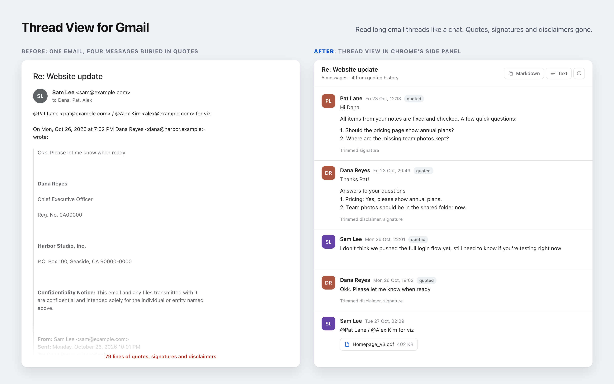

# Thread View for Gmail

Read long email threads like a chat. A Chrome extension that shows the Gmail thread you have open as a clean conversation in Chrome's side panel, with quotes, signatures and legal disclaimers stripped out.



## What it does

- **Every message, oldest first:** including messages buried inside quoted replies and forwards, which Gmail shows as one long email.
- **Only what's new:** quoted history, signatures, logos, legal footers and "Sent from my iPhone" are cut. A grey note says what was trimmed, and **Original** shows the untouched message.
- **Images and files stay:** inline screenshots appear in place; attachments download with one click.
- **Copy anything:** a message or the whole thread, as Markdown or plain text. Handy for pasting into docs, tickets or an AI chat.
- **Read-only and private:** it can't send, label, archive or change mail. Your mail goes from Google to your browser and nowhere else. No server, no analytics.

## Install with your AI agent (recommended)

Paste this into Claude Code, Codex, Cursor or any coding agent that can run commands:

```text
Install https://github.com/Jack-7xyz/gmail-thread-view for me. Follow its SETUP.md.
```

The agent clones the repo, runs the setup, and tells you exactly what to click in the few places only a person can (Google Cloud and Chrome). About 10 minutes the first time.

## Install by hand

You need Google Chrome, Git and Node.js 20+.

```bash
git clone https://github.com/Jack-7xyz/gmail-thread-view.git
```

```bash
cd gmail-thread-view && npm run setup
```

The setup walks you through it:
1. **Your own Google login client:** a free Google Cloud project with the Gmail API on. If you have the `gcloud` CLI, the script creates the project for you. Then two console pages: the login screen (choose **Internal** for a work account) and a **Web application** client with the redirect address the script prints.
2. **Build:** it writes your settings to `.env` and builds the extension into `dist/`.
3. **Load into Chrome:** `chrome://extensions`, turn on **Developer mode**, **Load unpacked**, pick `dist`.

Then open a Gmail thread and press **Alt+Shift+T** (or click the toolbar icon), click **Connect**, and drag the panel as wide as you like.

**Teams:** one person sets up the Google client, then shares the Client ID and Extension key (from their `.env`) with the team, for example in a password manager. Teammates run:

```bash
npm run setup -- --client-id=CLIENT_ID --extension-key=EXTENSION_KEY
```

**Update:** `git pull && npm run build`, then the reload icon on the extension in `chrome://extensions`.

## Why your own Google client?

Reading Gmail is a "restricted" permission. A public extension using it must pass Google's verification. With your own client set to **Internal**, only your organisation can sign in, and no review is needed. It costs nothing, and nobody else's project ever touches your mail.

Personal Gmail works too: choose **External** and add yourself as a test user. Google may ask you to sign in again now and then while the app is in testing.

## Using the panel

| Where | What it does |
| --- | --- |
| Header **Markdown** / **Text** | Copy the whole thread |
| Hover a message: **MD** / **Text** | Copy that message |
| Hover a message: **Original** | The message exactly as sent |
| **quoted** / **forwarded by** chip | Recovered from quoted or forwarded history |
| Attachment chip | Download the file |
| Click an image | Open it full size |

## Limits

- Cleaning is rule-based and tuned on English email from Gmail and Outlook. Odd signatures can slip through, and rarely a real line gets cut; **Original** is always one click away.
- Times on recovered messages are shown as their quoted header wrote them (the sender's time zone).
- Desktop Chrome only. Chrome Web Store listing: not yet.

## Develop

- `npm test`: engine, Gmail parsing and export tests. No dependencies.
- `npm run harness`, then open http://127.0.0.1:8787/dev/harness.html: the real panel with sample threads, no Gmail needed.
- [docs/how-it-works.md](docs/how-it-works.md): the cleaning rules. [AGENTS.md](AGENTS.md): code layout for agents.

Issues with a cleaning miss are welcome. Please anonymise the example (names, addresses, numbers) before posting.

## License

MIT. Not affiliated with Google. Gmail and Chrome are trademarks of Google LLC.
