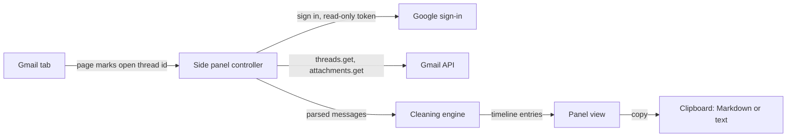
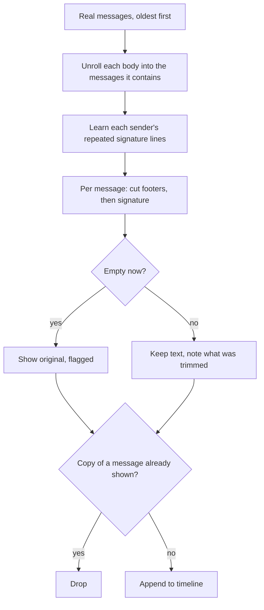

# How it works

The panel turns one Gmail thread into a timeline of every message it contains, then strips each message down to what it added. Everything runs in the browser: Gmail API in, cleaned timeline out.

## System at a glance



- **Thread id:** Gmail's page marks the open thread's subject with it; that id, converted to hex, is the Gmail API thread id. It's the only thing read from the page.
- **Token:** Chrome's web auth flow, read-only scope, kept in session memory.
- **Engine:** pure JS, same file in the panel and in Node tests.

## Flow



## Rules

```yaml
unroll_history:
  LOOP until no marker is left:
    own text = lines before the first of:
      - "---------- Forwarded message ---------"   # next message is "forwarded"
      - "-----Original Message-----"
      - Outlook "From: / Sent:" header block, with or without the ____ rule above it
      - "On <date> <name> wrote:"                  # Gmail may wrap this over two lines
      - a run of "> " lines with no header
    next sender and date = read from that marker's header
    next body = the lines after it, one "> " level removed IF Gmail quoted it
    # Outlook doesn't re-quote, so its history sits flat under each From/Sent block
  RETURN messages oldest first; the last one is the message's own text
```

```yaml
merge_timeline:
  LOOP over real messages, oldest first:
    LOOP over the messages each one contains, oldest first:
      IF it is the real message: append
      ELSE IF same sender AND 80% of the shorter text's words appear in an entry already shown: drop
      ELSE: append as "quoted" or "forwarded"
  # quoted copies get reflowed, re-bulleted or cut short, so exact matching fails
```

```yaml
cut_signature:
  first of these after the first line of content, within the last 25 non-blank lines:
    - "-- " separator
    - a sign-off alone on its line ("Cheers,", "Kind regards", "Thanks")
    - the sender's full or first name alone on its line   # many signatures start with the name, no sign-off
  ELSE:
    lines that end two or more of this sender's distinct messages, compared loosely
    strip a trailing run of them   # signatures with no name or sign-off
```

```yaml
cut_footers:
  cut from the first line matching: "Confidentiality Notice", "This email and any files transmitted",
    "intended solely for the individual", "Disclaimer:"
  drop lines: "Sent from my iPhone", "Get Outlook for iOS", external-sender warning banners
```

```yaml
rejoin_lines:
  # Gmail hard-wraps plain text near 76 characters
  join a line onto the previous one WHEN the previous source line was 60 to 80 characters
  EXCEPT when the line starts a bullet, a number, or a "Label:" such as "Status:"
```

```yaml
images:
  plain-text placeholders ("[image: ...]", "[cid:...]") become numbered markers
  the panel matches marker N to the Nth inline image in the message's HTML, or by content id
```

## Why plain text

Every marker above survives in Gmail's plain-text version of a message, for both Gmail and Outlook senders. One parser has fewer ways to fail than two. HTML is only used to match inline images, and to make text for HTML-only messages.

## Known quirks

- Quoted header times are in the sender's own time zone, so recovered messages can look out of order by clock. Order comes from nesting, which is reliable.
- A line like "Highlights: ..." stays on its own line because it looks like a label. That keeps "Status:" style lists intact.
